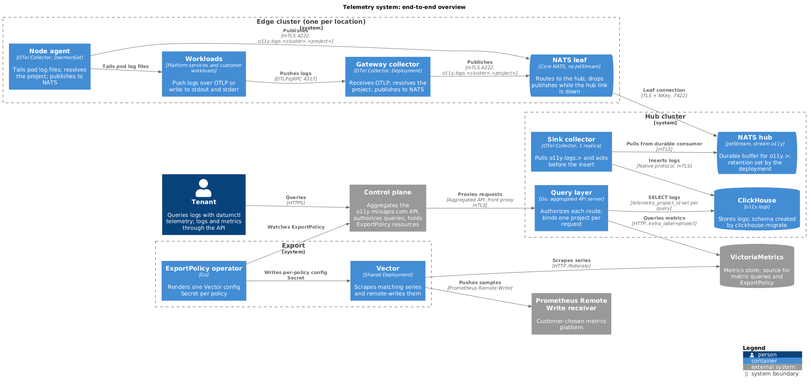

# Telemetry system

The telemetry system collects, durably stores, and exposes platform telemetry
for platform services and customer workloads. The pipeline is meant to carry
logs, metrics, traces, and network telemetry. Today the signals flow as
follows:

- **Logs** flow end to end. Edge collectors publish over NATS to a durable
  JetStream hub, a sink writes the stream into ClickHouse, and the query layer
  serves tenant-scoped log queries from ClickHouse.
- **Metrics** don't pass through this pipeline. The query layer answers tenant
  metric queries from VictoriaMetrics, and `ExportPolicy` exports metrics from
  VictoriaMetrics to a customer's Prometheus Remote Write receiver.
- **Traces and network telemetry** aren't carried yet. The hub grants edge
  locations the `traces` subject, but no collector publishes it and no
  consumer reads it.

Every read is bound to one project. No built path reads across projects.

## Guiding principles

- Use OpenTelemetry by default. Every collector and the sink are OpenTelemetry
  Collector deployments on one custom distribution.
- Minimize the number of database engines. Logs live in ClickHouse, and
  metrics stay in the existing Prometheus-compatible store.
- Don't store the same data more than once.
- Run every component as a self-managed workload on Kubernetes. The system uses
  no managed telemetry service.
- Support multi-tenancy as a first-class property. Every query binds to one
  project.
- Don't propagate hierarchical information outside the core control plane.
  Doing so risks it going out of sync or misattributing telemetry. The
  collectors resolve only the project, and records with no project use the
  reserved project `internal`.

## Conventions

These conventions apply to the whole system. Component docs reference them
instead of restating them.

- **Subject structure.** Collectors publish to NATS under
  `o11y.<signal>.<cluster>.<project>`. `<cluster>` is the publishing edge
  location's cluster name, and `<project>` is the record's project ID. Records
  that resolve to no project use the reserved project `internal`. Only
  `o11y.logs.<cluster>.<project>` is published today. The hub grants each
  location's NKey publish rights on `logs`, `metrics`, and `traces`, each
  limited to that location's cluster token. The grant limits which subjects a
  location can publish on. It doesn't check the payload: ClickHouse takes the
  project and cluster from the record's attributes, not from the subject. See
  [ingest-pipeline](./ingest-pipeline.md#subject-structure) and
  [edge-hub-trust](./edge-hub-trust.md#subject-scoping-and-its-limits).
- **Metrics export.** `ExportPolicy` doesn't use the NATS and ClickHouse
  pipeline. The operator renders each policy's `metricsql` selector, with the
  project label added, into a Vector `prometheus_scrape` source that reads
  VictoriaMetrics `/federate` and writes with Prometheus Remote Write. See
  [export-policies](./export-policies.md).
- **Tenant isolation in ClickHouse.** No password is used on this path: each
  telemetry client authenticates with a certificate whose common name names its
  ClickHouse user. The query layer takes the project from the identity the
  control plane forwards, never from the request. It adds an explicit
  `ProjectId = ?` predicate to every generated query and sets the custom
  setting `telemetry_project_id` on the query. The row policy
  `queryapi_project_isolation` filters `logs` on
  `ProjectId = getSetting('telemetry_project_id')`. A query that doesn't set
  the setting fails with `UNKNOWN_SETTING`. See
  [query-layer](./query-layer.md#tenant-enforcement). Metric queries have no
  database layer: the query layer adds `extra_label` and VictoriaMetrics
  enforces it.
- **NATS ports.** Local clients (collectors) connect to the edge NATS server on
  client port **4222** with mTLS. The leaf connection to the hub uses the NATS
  leafnode port **7422**, on a dedicated `LoadBalancer`, with NATS terminating
  TLS itself.
- **Retention.** Log retention comes from the TTL in migration `000003`,
  which hard-codes the periods. See [retention](./retention.md). The hub
  stream's `maxAge` and `maxBytes` are set by the deployment, not by this
  repository.

## Repositories

| Repository | Owns |
| --- | --- |
| [milo-os/telemetry](https://github.com/milo-os/telemetry) | Edge collector configuration, the custom `otelcol` distribution (`natsreceiver`, `natsexporter`, `unbatchprocessor`), the shared compute node collector base, `nkey-generator`, `clickhouse-migrate` and the schema, the query layer (`queryapi`), the `ExportPolicy` operator, the `datumctl telemetry` plugin and Go client (`cli/`), and the `milo-observe` Claude Code plugin (`claude-plugin/`) |
| [milo-os/resource-metrics](https://github.com/milo-os/resource-metrics) | `ResourceMetricsPolicy`, which derives metrics from control-plane resources and pushes them to the metrics store over OTLP |
| [network-services-operator](https://github.com/datum-cloud/network-services-operator) | Envoy Gateway lifecycle and access-log and metrics instrumentation |
| [unikraft-provider](https://github.com/datum-cloud/unikraft-provider) | Compute VM (Unikraft) metrics and logs at the source |
| Deployment repository (per provider) | GitOps deployment for every environment, environment-specific patches, the `o11y` JetStream stream, and alert rules |

`milo-os/telemetry`'s eventual rename to `milo-os/o11y` is a separate, gated
step and hasn't happened yet. These docs use `o11y` as the live naming
convention for the NATS subject root, ClickHouse database, namespace, and most
image paths. The operator, its CRD group, and the nkey generator image use
`telemetry`.

## System overview

The diagram shows the built system. On the write path, two edge collectors
(an OTLP gateway and a node agent) publish logs to a core NATS leaf, which
forwards to the JetStream hub. The sink collector writes the stream into
ClickHouse. On the read path, the query layer sits behind the control plane
and reads logs from ClickHouse and metrics from VictoriaMetrics. On the
export path, the operator configures one shared Vector, which scrapes
VictoriaMetrics and remote-writes to the customer's receiver.

## Components

| Component | Description |
| --- | --- |
| [ingest-pipeline](./ingest-pipeline.md) | Edge collectors, the core NATS leaf, the JetStream hub, and the sink consumer. Carries logs only. |
| [edge-hub-trust](./edge-hub-trust.md) | How edge locations and the hub establish trust on the leaf connection, and what the subject grant does and doesn't enforce |
| [logs](./logs.md) | The log pipeline and the ClickHouse log schema |
| [retention](./retention.md) | Log retention TTLs |
| [query-layer](./query-layer.md) | Aggregated API server that serves logs from ClickHouse and metrics from VictoriaMetrics, one project per request |
| [export-policies](./export-policies.md) | `ExportPolicy`, which exports a project's metrics to a Prometheus Remote Write receiver |
| [operations](../operations/README.md) | Signals to watch, runbooks, and correctness checks |
