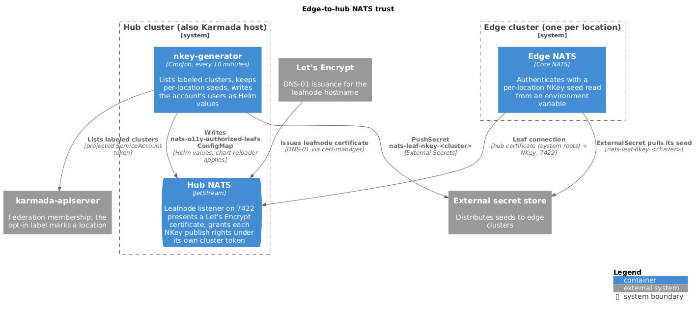

# Edge-to-hub NATS trust

Each edge location runs a core NATS server that connects to the hub over a
leaf connection. Trust on that hop is asymmetric, and the edge holds no CA
material. The hub presents a publicly trusted certificate on its leafnode
listener, which the edge verifies against system roots. Each location
authenticates with its own NATS NKey instead of a client certificate.

The hop isn't mutual TLS because the edge has no way to obtain a client
certificate that the hub's CA trusts without taking custody of CA keys or
shipping private keys to remote sites. The other hops in the
[ingest pipeline](./ingest-pipeline.md#transport-security) use mutual TLS.



- [Hub exposure](#hub-exposure)
- [Hub authorization](#hub-authorization)
- [Subject scoping and its limits](#subject-scoping-and-its-limits)
- [Edge configuration](#edge-configuration)
- [Credential generator](#credential-generator)
- [Failure modes](#failure-modes)

## Hub exposure

A dedicated `LoadBalancer` Service exposes only the leafnode port, 7422. It
doesn't expose the client port, 4222. NATS terminates TLS itself with a
Let's Encrypt certificate that cert-manager issues through DNS-01, so the
listener needs no port 80 reachability. The listener requires TLS first
(`handshake_first`), so every leaf remote must set it.

All hub replicas sit behind the one load balancer. A leaf connection can land
on any member, and the hub routes internally.

## Hub authorization

The `nkey-generator` CronJob in `o11y-system` runs every 10 minutes. It
writes the `O11Y` account's user list as Helm values into the
`nats-o11y-authorized-leafs` ConfigMap, under the `values.yaml` key. The
CronJob manifest isn't in this repository
([#145](https://github.com/milo-os/telemetry/issues/145)).

The hub's NATS Helm release reads the ConfigMap through `valuesFrom`. The
generator labels the ConfigMap `reconcile.fluxcd.io/watch: Enabled`, so Flux
re-reconciles the release when the ConfigMap changes. The chart re-renders
the NATS configuration with the users inlined, and the chart's config
reloader applies it without restarting the servers. Revocation takes effect
after the next generator run and a successful release reconcile.

The account has these users:

| User | Match | Publish | Subscribe |
| --- | --- | --- | --- |
| Edge location | NKey public key | `o11y.logs.<cluster>.*`, `o11y.metrics.<cluster>.*`, `o11y.traces.<cluster>.*` | `_INBOX.>` |
| `nack` | Certificate subject `CN=nack.nats.client` | `>` | `>` |
| Sink | Certificate subject `CN=o11y-sink-nats-client` | `$JS.API.>`, `$JS.ACK.>` | `o11y.>`, `_INBOX.>` |

The grant covers `logs`, `metrics`, and `traces`, and doesn't cover
`network`. A location can't publish network telemetry until the generator
adds an `o11y.network.<cluster>.*` grant. Only logs flow today.

Edge users hold no `$JS.API.*` grant. JetStream API access would let a holder
create a consumer over another location's subjects and read it back through
its own `_INBOX.>` subscription, which bypasses the publish scoping.

The sink user holds the whole JetStream API for the account, including stream
and consumer deletion, although the sink needs only consumer info, fetch, and
ack.

## Subject scoping and its limits

Each location's NKey can publish only under its own cluster token:

```text
o11y.<signal>.<cluster>.<project_id>
```

`<cluster>` is the Karmada `Cluster` name. A location therefore can't publish
on another location's subjects.

The grant scopes the subject only. The project token in the grant is a
wildcard, and the hub doesn't compare the payload with the subject. The sink
stores `ProjectId` from the payload's `milo.project.id` attribute and the
cluster from `k8s.cluster.name`. A compromised location can publish, on its
own cluster token, a record that claims any project and any cluster, and
ClickHouse stores it as that project's and that cluster's data. NKey scoping
limits which subjects a location can use. It doesn't limit what data a
location can inject.

No test publishes outside a grant and asserts a denial. The tests check the
shape of the generated permission map and that the collector manifests put
the cluster token in the subject. Neither shows the hub refusing a forged
publish.

## Edge configuration

The edge NATS server reads its seed from the `EDGE_NKEY_SEED` environment
variable, which comes from the `edge-leaf-nkey` Secret, key `edge.seed`. The
leaf remote references it:

```text
leafnodes {
  remotes: [
    {
      url: $NATS_HUB_LEAFNODE_URL
      nkey: $EDGE_NKEY_SEED
      tls: { handshake_first: true }
    }
  ]
}
```

The seed uses no persistent storage. Because it's an environment variable,
a running pod keeps the seed it started with, even after the Secret changes.
The server name, `edge-nats-<cluster>`, must be unique per location. See
[ingest-pipeline](./ingest-pipeline.md#edge-nats).

Collectors publish to the edge server over core NATS with no `stream` set.
The edge server doesn't buffer, so a publish during a hub outage is lost.

## Credential generator

`nkey-generator` ([`nkey-generator/`](../../nkey-generator/)) runs on the hub
cluster, which is also the Karmada host cluster, so `karmada-apiserver` is
reachable in-cluster. It authenticates with a projected ServiceAccount token.
Its Karmada RBAC is read-only on `clusters.cluster.karmada.io`.

A location receives a key only if it's a Karmada federation member
([#187](https://github.com/milo-os/telemetry/issues/187)) and carries the
label `telemetry.miloapis.com/nats-leaf=enabled`. Onboarding a location is
adding that label to its `Cluster`.

On each run, the generator lists the labeled clusters and skips any whose
name isn't a single DNS label, with a warning. For each remaining cluster it:

1. Generates a seed and public key into the Secret
   `nats-leaf-nkey-<cluster>` if the Secret doesn't exist. It never
   regenerates an existing key.
2. Creates or updates an External Secrets `PushSecret` that mirrors the seed
   to the configured secret store under the same name. The generator never
   calls the store's API itself.
3. Adds the location's user to the account's user list.

It then rewrites the ConfigMap. The deployment's edge `ExternalSecret` pulls
the seed from the store with `remoteRef.key: nats-leaf-nkey-<cluster>` and
writes it to `edge-leaf-nkey`.

## Failure modes

**A Karmada error changes nothing.** Any error listing clusters aborts the
run without writing.

**A listing that loses a location is refused.** If a location that the
previous ConfigMap authorized is missing from the new list and its
`nats-leaf-nkey-<cluster>` Secret still exists, the generator fails the run
instead of dropping the user. This guards against a successful but incomplete
listing.

**Decommissioning a location.** Remove the label or the `Cluster` object,
then delete its `nats-leaf-nkey-<cluster>` Secret. The run fails until the
Secret is gone, and then drops the user without further notice. Don't delete
the Secret of a location that's still labeled: the next run generates a new
seed.

**A new seed breaks a location** until the edge receives the new seed
through the next secret refresh and the edge NATS pod restarts to read it.
A change to the ConfigMap alone doesn't restart the pod.
