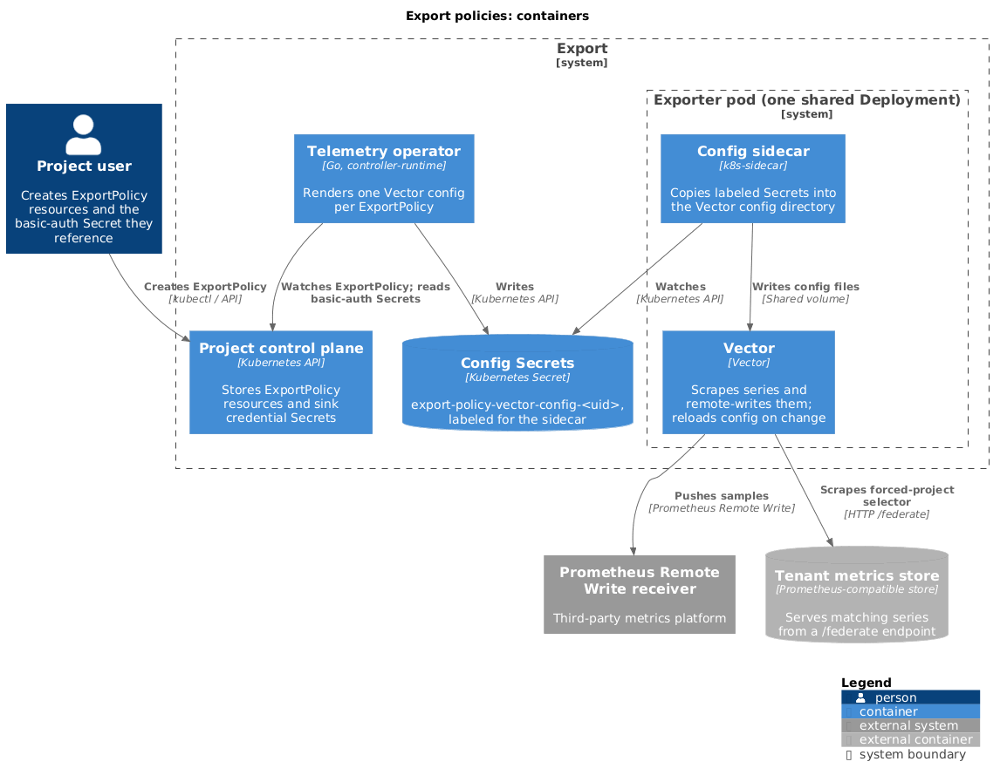

# Export policies

`ExportPolicy` is a project-scoped Kubernetes resource that forwards a
project's metrics to a Prometheus Remote Write receiver that the project
chooses. A controller renders each policy into a [Vector](https://vector.dev)
configuration, and one shared Vector deployment runs every policy.



## API

The API group is `telemetry.miloapis.com`. The types live in
[`operator/api/v1alpha1`](../../operator/api/v1alpha1/export_policy_types.go),
and the generated field reference is in
[`operator/docs/api/exportpolicies.md`](../../operator/docs/api/exportpolicies.md).

An `ExportPolicy` has named `sources` and named `sinks`. Each sink lists the
sources that feed it, so one policy can fan several sources out to several
receivers.

```yaml
apiVersion: telemetry.miloapis.com/v1alpha1
kind: ExportPolicy
metadata:
  name: example-export-policy
spec:
  sources:
    - name: application-metrics
      metrics:
        metricsql: '{service_name="gateway.networking.k8s.io", resource_kind="Gateway"}'
  sinks:
    - name: remote-receiver
      sources:
        - application-metrics
      target:
        prometheusRemoteWrite:
          endpoint: https://metrics.example.com/api/prom/push
          authentication:
            basicAuth:
              secretRef:
                name: receiver-credentials  # kubernetes.io/basic-auth Secret
```

The only source type is `metrics`, the only sink target is
`prometheusRemoteWrite`, and the only authentication is `basicAuth`. The
`secretRef` Secret must have type `kubernetes.io/basic-auth` and contain
`username` and `password`.

| Field | Constraint |
| --- | --- |
| `spec.sources` | 1 to 20 items |
| `spec.sinks` | 1 to 20 items |
| `sinks[].sources` | 1 to 20 names |
| `sources[].name`, `sinks[].name` | DNS label, at most 63 characters |
| `sinks[].target` | Required |
| `sources[].metrics` | Optional in the schema |

### The `metricsql` field

`metricsql` takes a series selector in MetricsQL syntax, such as
`{service_name="gateway.networking.k8s.io", resource_kind="Gateway"}`. The
operator parses it with the MetricsQL parser and uses only the selector.
Functions, aggregations, and range queries aren't supported.

### The `batch` and `retry` fields

The CRD accepts `batch` (`timeout`, `maxSize`) and `retry` (`maxAttempts`,
`backoffDuration`) on a Prometheus Remote Write sink and fills in defaults. The
operator doesn't write either into the Vector configuration, so Vector's own
batching and retry defaults apply whatever values you set.

## How it works

The operator, in
[`operator/internal/controller`](../../operator/internal/controller), watches
`ExportPolicy` resources in project control planes. For each policy it renders a
Vector configuration and stores it as a Secret named
`export-policy-vector-config-<uid>` in the namespace given by the operator's
`--vector-config-namespace` flag. Deleting a policy removes its Secret through
the finalizer `exportpolicy.telemetry.miloapis.com/controller`. The operator
also reconciles again when a sink's credential Secret changes.

One shared Vector Deployment, defined in
[`config/operator/vector`](../../config/operator/vector/deployment.yaml), runs
every policy. It has one replica and two containers:

- A `k8s-sidecar` container watches Secrets labeled
  `telemetry.miloapis.com/vector-export-policy-config` in all namespaces and
  writes each one into the Vector configuration directory.
- A `vector` container runs with `--watch-config` and reloads when files
  change.

For each source the operator renders a `prometheus_scrape` Vector source that
reads a Prometheus-compatible `/federate` endpoint, with the selector passed as
`match[]`. The endpoint, and the optional basic-auth credentials for it, come
from the operator's `TELEMETRY_SERVICE_METRICS_ENDPOINT`,
`TELEMETRY_SERVICE_METRICS_USERNAME`, and
`TELEMETRY_SERVICE_METRICS_PASSWORD` environment variables. The store behind
that endpoint is a Prometheus-compatible store that holds the resource metrics
the platform publishes to projects. Export doesn't read the NATS and ClickHouse
log pipeline. Vector scrapes on its default interval of 15 seconds, because the
operator doesn't render `scrape_interval_secs`.

Each sink becomes a `prometheus_remote_write` Vector sink with the endpoint and
basic-auth credentials from the policy. The operator copies the username and
password into the rendered configuration, so they are stored in the config
Secret in the exporter's namespace. The sidecar's service account can get, list,
and watch Secrets cluster-wide.

### Tenant isolation

The operator appends a matcher for the policy's project
(`resourcemanager_datumapis_com_project_name`) to every selector group. A policy
therefore reads only series from its own project, whatever selector the user
writes. If the selector has no label matchers, the project matcher is the only
one.

Each policy's sources and sinks are separate Vector components. Their IDs have
the form `export-policy:<project>:<namespace>:<name>:<uid>:<component>-<type>`,
so a sink's inputs reference only that policy's sources. The policies share one
process, so a Vector failure affects every policy.

### Delivery

Delivery is best-effort. Vector retries transient errors and drops a batch
that the receiver rejects. Federation returns only the latest sample of each
series, so Vector doesn't backfill samples for periods when it wasn't scraping,
such as a restart. The API's own field documentation makes no delivery
guarantee.

### Exporter metrics

[`base-vector-config.yaml`](../../config/operator/vector/base-vector-config.yaml)
relabels Vector's component metrics for each export-policy source and sink. The
metrics carry `service_name="telemetry.miloapis.com"`,
`resource_kind="ExportPolicy"`, the project, namespace, name, and UID of the
policy, and `source_name` or `sink_name`. Vector serves them on port 9598, and a
`ServiceMonitor` scrapes them. A deployment can federate them into the tenant
metrics store, which lets a project export its own delivery metrics.

## Status

`status.conditions` has a `Ready` condition. It's `True` with reason
`SinksAccepted` when every sink is accepted, and `False` with reason
`SinksNotAccepted` otherwise. The message reports how many sinks are accepted.
Each entry in `status.sinks` has an `Accepted` condition, with reason
`SinkConfigured` or `InvalidAuthentication`.

A sink is `Accepted` when its authentication Secret exists, has type
`kubernetes.io/basic-auth`, and has `username` and `password` keys. The
conditions don't check that the selector is valid, that the receiver is
reachable, or that Vector loaded the configuration. To see delivery, use the
exporter's per-policy metrics.

## Known limitations

- **No admission validation.** The repository has a validating webhook for
  `ExportPolicy`, but the operator doesn't register it
  ([`operator/cmd/main.go`](../../operator/cmd/main.go)) and
  `config/operator/default` doesn't include it. Only the CRD's OpenAPI schema
  applies at admission. A source with no `metrics`, a query that isn't a
  selector, and a sink that names an undefined source all reach the controller.
- **One bad policy can affect others.** If a source's `metricsql` doesn't parse,
  the operator skips the source but still lists it as a sink input. Vector
  rejects a configuration whose sink references an unknown input, and all
  policies share one configuration directory. A query that parses but isn't a
  selector, such as `rate(x[5m])`, isn't handled by the controller and fails
  reconciliation of that policy. `Ready` is still `True` in both cases, because
  it checks only authentication.
- **`batch` and `retry` are ignored.** See
  [The `batch` and `retry` fields](#the-batch-and-retry-fields).
- **One exporter replica.** The shared Deployment has one replica, so an
  exporter restart pauses every policy.
- **Metrics and Prometheus Remote Write only.** Log export, other sink
  protocols, and bearer-token authentication don't exist.
- **Project scope only.** The only parent context is a project.
