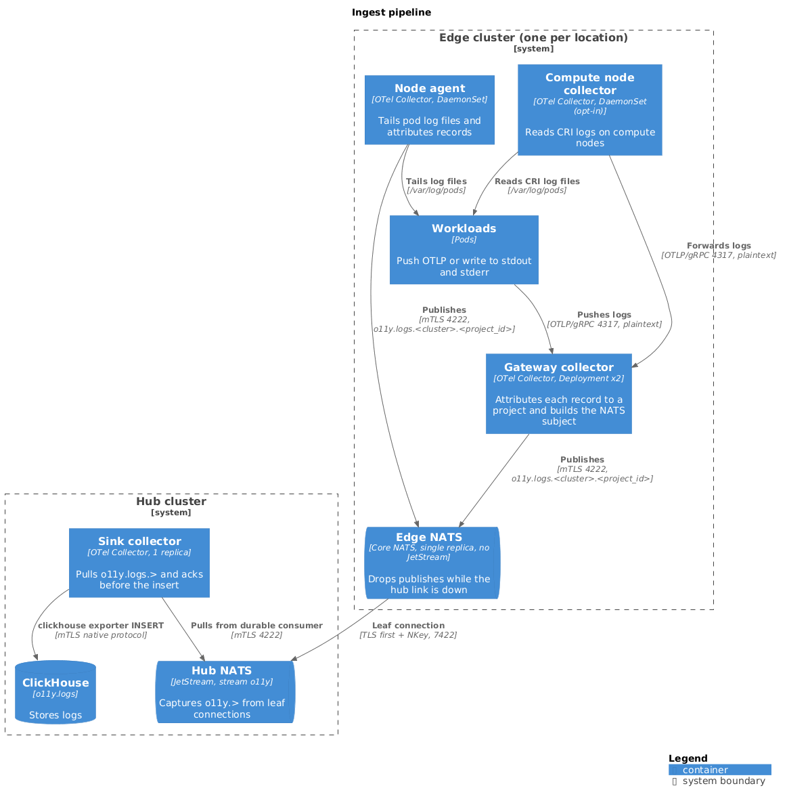

# Ingest pipeline

The ingest pipeline carries logs from edge clusters to ClickHouse. Collectors
at each edge location attribute every record to a project and publish it to a
local NATS server. That server forwards to a JetStream hub, and a sink
collector on the hub reads the stream and hands records to the ClickHouse
exporter. Logs are the only signal the pipeline carries today.



- [Subject structure](#subject-structure)
- [Edge collectors](#edge-collectors)
- [Attribution and per-project routing](#attribution-and-per-project-routing)
- [NATS exporter](#nats-exporter)
- [Edge NATS](#edge-nats)
- [Hub JetStream stream](#hub-jetstream-stream)
- [ClickHouse consumer](#clickhouse-consumer)
- [Transport security](#transport-security)
- [Delivery behavior and known defects](#delivery-behavior-and-known-defects)

## Subject structure

Collectors publish each record to a four-token subject:

```text
o11y.logs.<cluster>.<project_id>
```

- `<cluster>` is the edge cluster's name, which the deployment fills into the
  collector's `${cluster}` placeholder. It must equal the federation `Cluster` name
  that keys the location's NATS credential (see
  [edge-hub-trust](./edge-hub-trust.md#hub-authorization)).
- `<project_id>` is the record's `milo.project.id`. Records that resolve to no
  project use the reserved value `internal`.

The collectors write the project ID into the subject without sanitizing it. A
value that contains `.`, `*`, or `>` produces a subject outside the
location's publish grant. The hub then denies the publish, and nothing
reports the denial at the edge. A cluster-name mismatch has the same effect.

The stream captures `o11y.>`, and the sink consumes `o11y.logs.>`. The sink
doesn't read the subject: it takes the project from the payload (see
[Attribution and per-project routing](#attribution-and-per-project-routing)).

Each NATS message carries one OTLP record and is subject to the server's
maximum payload, which is 1 MiB unless the deployment changes it. A single
record larger than that is rejected.

## Edge collectors

Every edge cluster runs two collectors that publish to the edge NATS server.
Both use the custom collector distribution in [`otelcol/`](../../otelcol/),
which bundles the NATS exporter, the NATS receiver, and the unbatch processor
with the contrib components.

| Collector | Kind | Source | Manifest |
| --- | --- | --- | --- |
| Gateway collector | Deployment, 2 replicas | OTLP/gRPC on port 4317 from senders that speak OTLP | [`gateway-collector.yaml`](../../config/collectors/gateway-collector.yaml) |
| Node agent | DaemonSet | Container log files under `/var/log/pods` on its own node | [`node-agent-collector.yaml`](../../config/collectors/node-agent-collector.yaml) |

The gateway collector's pipeline runs `memory_limiter`,
`transform/observed_time`, `groupbyattrs`, `k8sattributes`, `resource`,
`transform/milo_project_id`, `batch`, and `unbatch`, then exports to NATS. The
`transform/observed_time` processor stamps the observed timestamp at receipt,
because the OTLP receiver leaves it unset.

The node agent discovers pods through `k8s_observer` and starts a `filelog`
receiver for each one with `receiver_creator`. It skips pods in `o11y-system`
and pods labeled `telemetry.miloapis.com/otlp-native-logs=true`, which push
OTLP to the gateway instead. It starts reading at the end of each file. Its
pipeline matches the gateway's without `transform/observed_time`, because
`filelog` sets the timestamp, and without `groupbyattrs`, because every
record comes from one pod.

### Shared compute node collector

[`config/node-collector/`](../../config/node-collector/) is an opt-in base
for one collector per compute node. It doesn't replace the node agent
automatically: the deployment composes it with provider-owned components for
the compute nodes and stops the node agent on those nodes, because running
both duplicates records.

The base reads CRI log files, forwards namespace labels as resource
attributes, drops records from opted-out pods, and exports logs to the gateway
collector over OTLP/gRPC. The gateway then attributes and publishes them like
any other OTLP sender. Differences from the node agent:

- It starts reading at the beginning of retained files and keeps offsets and
  its sending queue on a node `hostPath` through `file_storage`. A cutover
  replays retained logs.
- Its OTLP connection to the gateway is plaintext, and the gateway doesn't
  authenticate it.
- It declares a Prometheus remote-write exporter for provider components.
  Metrics sent that way go to the metrics store and don't pass through NATS.

## Attribution and per-project routing

Attribution happens inside the edge collectors. There's no separate bridge
service.

1. `groupbyattrs` splits an OTLP batch into one Resource per `project_name`
   value. A single sender can batch records from many projects under one
   Resource, and `milo.project.id` is resource-scoped.
2. `k8sattributes` reads the sender pod's namespace labels
   (`resourcemanager.miloapis.com/project-name` and
   `meta.datumapis.com/upstream-cluster-name`) for senders that don't set
   `project_name`. The gateway associates a record with a pod by connection
   address. The node agent associates by `k8s.pod.uid`.
3. `resource` sets `k8s.cluster.name` from the `CLUSTER_NAME` variable.
4. `transform/milo_project_id` derives `milo.project.id` and builds the
   `telemetry.subject` attribute.

The gateway applies four tiers in order, and the first match wins:

1. The sender-set `project_name` resource attribute.
2. The namespace's `resourcemanager.miloapis.com/project-name` label.
3. The namespace's `meta.datumapis.com/upstream-cluster-name` label, with a
   leading `cluster-` removed.
4. The reserved value `internal`.

The node agent applies tiers 2 through 4. See the
[resource attribute contract](./logs.md#resource-attribute-contract) for the
attribute definitions.

Attribution has these properties:

- **Anything that reaches port 4317 chooses its project.** The gateway doesn't
  authenticate senders. `auth_type: serviceAccount` on `k8sattributes` is the
  processor's credential for reading the Kubernetes API, not a check on
  senders. A sender that sets `project_name` takes precedence over namespace
  labels. Network policy is the only boundary.
- **Unresolved records aren't dropped.** They fall through to `internal`.
- **The pipeline doesn't validate the project ID** against a registry.
- **Storage trusts the payload.** The sink doesn't read the subject.
  ClickHouse derives `ProjectId` from the `milo.project.id` resource
  attribute and the cluster from `k8s.cluster.name`, and both come from the
  record. See [edge-hub-trust](./edge-hub-trust.md#subject-scoping-and-its-limits).

## NATS exporter

The `nats` exporter ([`exporter/natsexporter/`](../../exporter/natsexporter/))
publishes each record to the edge NATS server over core NATS. No `stream` is
configured, so there's no publish acknowledgment. It encodes records as
`otlp_proto` and takes the subject from the `telemetry.subject` attribute
(`subject_from_attribute`). It falls back to `o11y.logs.<cluster>.internal`
when the attribute is missing.

The `batch` processor amortizes the enrichment steps across many records.
The `unbatch` processor
([`processor/unbatchprocessor/`](../../processor/unbatchprocessor/)) then
splits the batch so each outgoing message carries one record.

The exporter connects with the `nats.go` defaults, which allow 60 reconnect
attempts at 2 second intervals. If the edge NATS server stays down for about
two minutes, the connection closes for good. Every later publish fails until
the collector restarts, and nothing reports the closed connection.

## Edge NATS

Each edge cluster runs a single-replica core NATS server named `nats`
([`nats.yaml`](../../config/collectors/nats.yaml)). It has no JetStream and no
persistent storage.

- Collectors connect on client port 4222 with mutual TLS. A cert-manager CSI
  volume supplies the server and client certificates.
- A leaf connection to the hub forwards traffic. The server authenticates with
  an NKey seed that it reads from the `EDGE_NKEY_SEED` environment variable,
  sourced from the `edge-leaf-nkey` Secret. The remote sets
  `tls.handshake_first`, because the hub's leafnode listener requires TLS
  first.
- The server name is `edge-nats-<cluster>` and must be unique per location.
  The hub keys leaf connections on the name and evicts the existing
  connection when another connects with the same name.
- A metrics sidecar exports server, connection, subscription, and leaf
  metrics.

**The edge server doesn't buffer.** Core NATS has no store-and-forward. The
hub's subscription interest in `o11y.>` reaches the edge server only through
the leaf connection. While that connection is down, the edge server has no
subscriber for the telemetry subjects and discards each message at once. The
exporter's publish to the local server still succeeds, so neither the
exporter's retry nor its sending queue engages. Records that edge collectors
publish during a hub or WAN outage are lost, and the collectors don't see an
error. Durability begins at the hub.

## Hub JetStream stream

The hub runs a clustered NATS deployment with JetStream. The deployment
declares the stream and the sink's consumer, for example as NACK `Stream` and
`Consumer` resources. This repository ships neither, so the stream's
retention, replica count, and size limits are deployment values.

The sink depends on this configuration:

| Setting | Value the sink expects |
| --- | --- |
| Stream name | `o11y` |
| Stream subjects | `o11y.>` |
| Capture | Subject capture of messages that edge leaves publish over core NATS. The stream has no `sources` or `mirror`. |
| Consumer name | `o11y-sink-collector` |
| Consumer type | Durable, pull, explicit ack |
| Consumer filter | `o11y.logs.>` |

Publishes carry no message ID, so the stream's duplicate window removes
nothing. The `o11y.logs` table has no deduplication. Recreating the consumer
with a deliver policy of `all` replays the whole retained stream into the
table, so recreate it with an explicit start sequence or time.

The hub's NATS configuration, which the deployment owns, sets these
behaviors that affect ingest:

- The leafnode listener requires TLS first and authenticates leaves by NKey.
  The hub doesn't advertise its peer servers to leaves (`no_advertise`).
- Leaf connections negotiate S2 compression.
- The client port maps a client certificate's subject to a NATS user
  (`verify_and_map`), and cluster routes use mutual TLS.

The hub exposes only the leafnode port (7422) externally. See
[edge-hub-trust](./edge-hub-trust.md#hub-exposure).

## ClickHouse consumer

The sink is an OTel Collector, `o11y-sink-collector`
([`sink-collector.yaml`](../../config/collectors/sink-collector.yaml)). Its
`nats` receiver binds the existing durable consumer with `nats.go/jetstream`'s
`Consume()` and runs the pipeline `memory_limiter`,
`transform/observed_time`, `batch`, then the contrib `clickhouse` exporter.
The `clickhouse` exporter writes to the `o11y.logs` table. See
[logs](./logs.md#clickhouse-schema) for the schema.

The collector runs one replica. The receiver binds a single durable pull
consumer, and a second replica would race it for the same messages. The
pipeline carries logs only: the receiver's metrics and traces subjects are
unused placeholders.

The `transform/observed_time` processor copies the observed timestamp into the
`telemetry.observed_time_unix_nano` log attribute. The schema materializes the
`ObservedTimestamp` column from that attribute, so a key mismatch silently
reads as 1970.

The `batch` processor groups 8192 records or waits 10 seconds. The
`clickhouse` exporter retries a failed insert with backoff for up to 300
seconds.

### Receiver behavior

The receiver ([`receiver/natsreceiver/`](../../receiver/natsreceiver/)):

- Never creates the stream or consumer. A misnamed consumer fails at startup.
- Reconnects to the hub indefinitely and resubscribes after a missed
  heartbeat, such as a consumer leader election. It counts resubscribes in
  `natsreceiver_resubscribe_total`.
- Exits fatally if the consumer or stream is deleted or the connection closes.
- Acks a message when `ConsumeLogs` returns without error, and sends
  `NakWithDelay` (2 seconds) when it returns a retryable error.
- Acks and drops a payload that fails to unmarshal, and logs an error.
- Reports `natsreceiver_seconds_since_last_delivery`.

**The sink acks before the insert succeeds.** The `batch` processor sits ahead
of the exporter and returns as soon as it enqueues a batch, so `ConsumeLogs`
returns before any insert runs. The receiver acks the message at that point. An
insert that fails after the exporter's retries is lost, and JetStream doesn't
redeliver. The nak path runs only when `memory_limiter` refuses a batch. See
[milo-os/telemetry#235](https://github.com/milo-os/telemetry/issues/235).

## Transport security

| Hop | Transport | Authentication |
| --- | --- | --- |
| Sender to gateway collector (port 4317) | OTLP/gRPC, plaintext | None. Network policy restricts access. |
| Compute node collector to gateway collector | OTLP/gRPC, plaintext | None. Network policy restricts access. |
| Collector to edge NATS (port 4222) | Mutual TLS | Client certificate from cert-manager (CSI) |
| Edge NATS to hub (port 7422) | TLS with the hub's public certificate, TLS first | Per-location NKey |
| Hub NATS route to route | Mutual TLS | Server certificates |
| Sink to hub NATS (port 4222) | Mutual TLS | Client certificate mapped to a NATS user |
| Sink to ClickHouse (secure native port) | Mutual TLS | Client certificate mapped to a ClickHouse user |

The leaf hop is asymmetric on purpose: the edge holds no CA material and no
client certificate. [edge-hub-trust](./edge-hub-trust.md) describes it.

## Delivery behavior and known defects

| Event | Result |
| --- | --- |
| Hub unreachable from an edge location | Edge NATS drops published records. Collectors see no error. |
| Edge NATS down for more than about two minutes | The exporter's connection closes permanently. Publishes fail until the collector restarts. |
| Hub publish denied (bad subject token or cluster-name mismatch) | The hub drops the record. Nothing reports it at the edge. |
| Sink down or ClickHouse slow | Records wait in the stream until the stream's retention discards them. |
| ClickHouse insert fails after retries | The sink has already acked the message, so the record is lost ([#235](https://github.com/milo-os/telemetry/issues/235)). |
| Record fails to unmarshal | The receiver acks it and logs an error. |
| Sink consumer deleted | The receiver exits fatally. |
