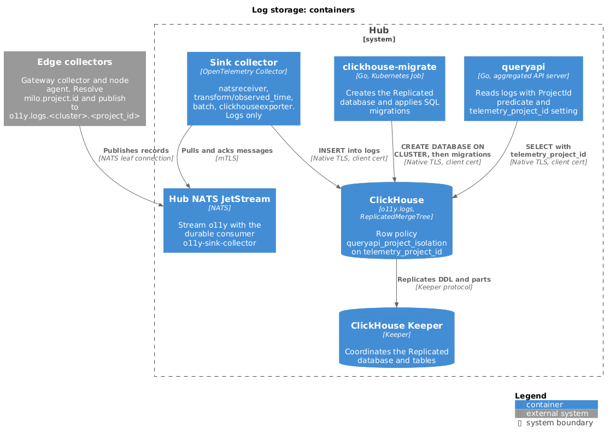

# Logs

Logs flow from edge collectors through NATS into the ClickHouse table
`o11y.logs`. Every record carries a project ID, and the query layer reads only
the rows of the caller's project. This document covers what the pipeline
stamps on each record, how the table is built, and how tenant isolation works.



## Resource attribute contract

The edge collectors resolve `milo.project.id` on every log record before the
`nats` exporter publishes it. `milo.project.id` is a resource attribute. The
collector chain (`groupbyattrs`, `k8sattributes`, `transform/milo_project_id`)
is described in
[ingest-pipeline](./ingest-pipeline.md#attribution-and-per-project-routing).

The gateway collector resolves the value in this order:

1. **An attribute the sender already stamped.** A sender such as Envoy
   (through `network-services-operator`) sets `project_name`. The gateway
   collector uses it unless it is empty or the literal `"-"` that Envoy emits
   when a route has no metadata. `groupbyattrs` first splits a batch by
   `project_name`, because one Envoy batch can hold records for many projects.
2. **`resourcemanager.miloapis.com/project-name`** on the pod's namespace,
   read by `k8sattributes`. The value is used as is.
3. **`meta.datumapis.com/upstream-cluster-name`** on the pod's namespace, with
   the `cluster-` prefix removed.
4. **`internal`**, when none of the above resolve.

The node agent applies steps 2 through 4. It doesn't read `project_name`. No
list of platform namespaces exists: `internal` is the fall-through default, so
a source the collectors don't otherwise account for lands in `internal` rather
than under a tenant project.

The collectors also set `k8s.cluster.name`, `service.namespace` (from the
namespace), and `service.name` (from the container name, when the sender sets
none). The `transform/milo_project_id` processor builds the NATS subject
`o11y.logs.<cluster>.<project_id>` in the `telemetry.subject` attribute, and
the `nats` exporter publishes to it.

Records carry the project ID and no organization or folder. The query layer
resolves access from the control plane when it reads.

The collectors forward every record once `milo.project.id` resolves. No policy
gate exists.

## Ingest path

```text
Edge collector -> edge NATS leaf -> hub JetStream stream o11y
                                      -> sink collector -> o11y.logs
```

The sink is an OpenTelemetry Collector that binds a durable consumer on the
hub stream and writes with the contrib `clickhouseexporter`. It writes logs
only. [ingest-pipeline](./ingest-pipeline.md) describes each hop and its
failure behavior.

The sink acks a message before the ClickHouse insert succeeds, so an insert
that fails after the exporter's retries loses the record
([milo-os/telemetry#235](https://github.com/milo-os/telemetry/issues/235)).
Delivery into ClickHouse isn't at-least-once.

## ClickHouse schema

`clickhouse-migrate` builds the schema. It creates the `Replicated` database
and then applies the migrations in
[`config/clickhouse-migrations/migrations`](../../config/clickhouse-migrations/migrations):

| Migration | Adds |
| --- | --- |
| `000001_init` | The `logs` table and the row policy `queryapi_project_isolation` |
| `000002_labels_column` | The `Labels` column |
| `000003_log_retention` | Storage policy and TTL; see [retention](./retention.md) |

The exporter never creates the table (`create_schema: false`).

### Table definition

`logs` uses `ReplicatedMergeTree` inside a `Replicated` database coordinated by
ClickHouse Keeper, so DDL and data reach every replica.

| Setting | Value |
| --- | --- |
| Engine | `ReplicatedMergeTree`, with the Keeper path and replica name taken from the database |
| `PARTITION BY` | `toYYYYMM(ObservedTimestamp)` |
| `ORDER BY` | `(ProjectId, ObservedTimestamp, ServiceName)` |
| TTL and storage policy | Set by `000003`; see [retention](./retention.md) |

The table has no column codecs and no data-skipping indexes.

### Columns

The first group of columns is the set the exporter inserts, in the exporter's
order. The last three are `MATERIALIZED`: ClickHouse computes them on insert,
and the exporter never writes them.

| Column | Type | Notes |
| --- | --- | --- |
| `Timestamp` | `DateTime64(9)` | OTLP event time. Can be 0 when the source sets none, so queries don't key on it |
| `TraceId` | `String` | Trace context; empty unless the source sets it |
| `SpanId` | `String` | Trace context; empty unless the source sets it |
| `TraceFlags` | `UInt8` | Trace context |
| `SeverityText` | `LowCardinality(String)` | For example `INFO` or `ERROR` |
| `SeverityNumber` | `UInt8` | OTLP severity number, 1 to 24 |
| `ServiceName` | `LowCardinality(String)` | `service.name` |
| `Body` | `String` | Log message |
| `ResourceSchemaUrl` | `LowCardinality(String)` | |
| `ResourceAttributes` | `Map(String, String)` | |
| `ScopeSchemaUrl` | `LowCardinality(String)` | |
| `ScopeName` | `String` | |
| `ScopeVersion` | `LowCardinality(String)` | |
| `ScopeAttributes` | `Map(String, String)` | |
| `LogAttributes` | `Map(String, String)` | |
| `EventName` | `String` | Empty unless the source sets it |
| `ObservedTimestamp` | `DateTime64(9) MATERIALIZED` | Partition and order key. See below |
| `ProjectId` | `String MATERIALIZED` | `ResourceAttributes['milo.project.id']` |
| `Labels` | `Map(String, String) MATERIALIZED` | Both attribute maps merged. See below |

#### `ObservedTimestamp`

The exporter's `INSERT` has no `ObservedTimestamp` column, so the value
travels as a log attribute through three files:

1. The gateway collector
   ([`gateway-collector.yaml`](../../config/collectors/gateway-collector.yaml))
   sets `observed_time_unix_nano` to the current time when it is 0, which is
   the case for OTLP senders. The node agent's `filelog` receiver sets it when
   it reads a line. A value the source set is kept.
2. The sink
   ([`sink-collector.yaml`](../../config/collectors/sink-collector.yaml))
   copies a nonzero observed time into the log attribute
   `telemetry.observed_time_unix_nano`.
3. The column in `000001_init.up.sql` parses that attribute. If the attribute
   is missing or empty, the column falls back to `now64(9)`, the insert time.

The three files must agree on the attribute key. A mismatch doesn't fail: rows
silently get the insert time. `TestObservedTimeAttributeIsPlumbedEndToEnd` in
[`config/manifest_test.go`](../../config/manifest_test.go) guards the key. The
query layer hides the attribute from label sets.

Because collector receipt time is the key, a backlog drain after an outage
doesn't move a record's time.

#### `Labels`

`Labels` merges `LogAttributes` and `ResourceAttributes` and replaces each `.`
in a key with `_`, because LogQL label names can't contain dots. `LogAttributes`
comes first. When a key appears in both maps, `Labels[k]` returns the first
match, so the record-level value wins. The mapping is one-way: `k8s.pod.name`
and `k8s_pod_name` collapse to one name. Label matchers and label discovery in
the query layer read only this column.

Migration `000002` doesn't rewrite existing parts. Parts written earlier lack
`Labels` values until a mutation (`MATERIALIZE COLUMN`) or the TTL replaces
them.

### Tenant isolation

Tenant isolation has two parts in the code, both keyed on the project ID.

**Row policy.** Migration `000001` creates `queryapi_project_isolation` on
`logs`:

```sql
CREATE ROW POLICY IF NOT EXISTS queryapi_project_isolation
ON logs
FOR SELECT
USING ProjectId = getSetting('telemetry_project_id')
TO `{{QUERYAPI_USER}}`;
```

`clickhouse-migrate` renders `{{QUERYAPI_USER}}` from
`CLICKHOUSE_QUERYAPI_USER` (default `queryapi`), which must match the common
name of the query layer's client certificate.

**Custom setting.** The query layer sets the custom setting
`telemetry_project_id` on every query. The deployment registers the
`telemetry_` prefix in `custom_settings_prefixes`, and the query layer's
read-only profile needs a `changeable_in_readonly` constraint on the setting.
Without it, `readonly=1` rejects the setting.

**Predicate.** Every generated query also carries `ProjectId = ?` for the
request's project. See
[query-layer](./query-layer.md#tenant-enforcement).

A query that doesn't set `telemetry_project_id` fails with `UNKNOWN_SETTING`.
The policy fails closed with an error, not with an empty result. This holds
only while no default exists for the setting.

### Identities

The sink, the query layer, and the migration job authenticate to ClickHouse
with client certificates. The certificate's common name names the ClickHouse
user. The deployment declares the users and the query layer's `SELECT` grant
in its `users.d` configuration, because SQL can't grant to users declared in
XML. The migration only attaches the row policy to the query layer's user.

### Deployment prerequisites

The migrations need the following from the deployment:

- A cluster name that matches `CLICKHOUSE_CLUSTER`, and ClickHouse Keeper.
- `{shard}` and `{replica}` macros.
- The `hot_cold` storage policy; see [retention](./retention.md#storage-policy).
- A certificate-mapped migration user that can create databases, tables, and
  row policies.
- `CLICKHOUSE_QUERYAPI_USER` set to the query layer's common name.

## Query access

The query layer serves logs and metrics over a Loki- and Prometheus-shaped
HTTP API. It reads logs from `o11y.logs`. See [query-layer](./query-layer.md)
for authentication, the LogQL subset, and limits.
