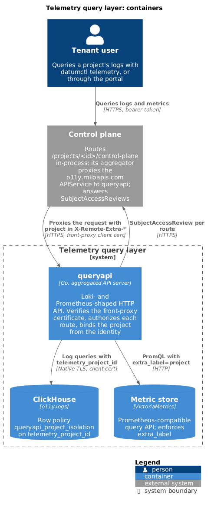

# Query layer

The query layer is the read path of the telemetry system. `queryapi` is a Go
aggregated API server that answers Loki-shaped log queries from ClickHouse and
Prometheus-shaped metric queries from a Prometheus-compatible store
(VictoriaMetrics in practice). Every request is authorized by the control plane
and bound to exactly one project.



> Last verified: 2026-11-10 against v0.6.9

## Components

| Component | Code | Role |
| --- | --- | --- |
| `queryapi` | [`queryapi/`](../../queryapi/) | Aggregated API server. Authenticates the forwarded identity, authorizes each route, binds the project, and queries a backend. |
| Log store | [`queryapi/internal/storage/clickhouse`](../../queryapi/internal/storage/clickhouse/) | The `o11y.logs` table, written by the sink. See [logs](./logs.md). |
| Metric store | [`queryapi/internal/storage/prometheus`](../../queryapi/internal/storage/prometheus/) | Any server that implements the Prometheus query HTTP API and honors `extra_label`. |
| `datumctl telemetry` | [`cli/`](../../cli/) | A `datumctl` plugin (binary `milo-telemetry`) and Go client for logs. |
| `milo-observe` plugin | [`claude-plugin/`](../../claude-plugin/) | Claude Code skills. The `query-logs` skill drives `datumctl telemetry`. |

The customer portal calls the log and metric routes through the same
per-project path. `queryapi` serves project-scoped callers only. No route
reads across projects, and there is no operator or Grafana path that bypasses
the project binding. A Grafana Loki datasource can target one project's path,
which is why the `/loki/api/v1/...` alias and the `vector(1)+vector(1)`
health-probe answer exist.

## Request path

Clients call the control plane, not `queryapi`:

```text
/apis/resourcemanager.miloapis.com/v1alpha1/projects/<id>/control-plane/apis/o11y.miloapis.com/v1alpha1/logs/loki/api/v1/query_range
```

1. The control plane's project router strips
   `/projects/<id>/control-plane` in-process and records the project on the
   caller's identity.
2. The control plane's aggregator authorizes the proxy hop, then proxies the
   request to `queryapi` over TLS with a front-proxy client certificate. The
   identity travels as `X-Remote-User`, `X-Remote-Uid`, `X-Remote-Group`, and
   `X-Remote-Extra-*` headers.
3. `queryapi` verifies the certificate, rebuilds the identity, authorizes the
   route with a SubjectAccessReview to the control plane, and binds the
   project to the query.

### API registration

The deployment applies
[`config/queryapi-api-registration`](../../config/queryapi-api-registration/apiservice.yaml)
to the control plane. It registers one APIService, `v1alpha1.o11y.miloapis.com`
(group `o11y.miloapis.com`, version `v1alpha1`), pointing at the `queryapi`
Service on port 443.

`queryapi` serves the group's discovery documents. The aggregator probes
`/apis/o11y.miloapis.com/v1alpha1` and never proxies to an APIService whose
probe fails. The resource list is empty because `queryapi` serves no Kubernetes
resources. `logs` and `metrics` name permissions, not REST collections.

The APIService has no `caBundle` and doesn't skip TLS verification. The
serving certificate, issued through the cert-manager CSI driver in
[`config/queryapi/deployment.yaml`](../../config/queryapi/deployment.yaml),
must chain to a CA the aggregator already trusts. The
[`NetworkPolicy`](../../config/queryapi/networkpolicy.yaml) admits ingress on
port 8443 only from the control plane's namespace.

## Authentication and authorization

A request must pass two gates, both decided by the control plane.

### Authentication

`queryapi` uses the `k8s.io/apiserver` delegating authenticator. It believes
the `X-Remote-*` headers only on a TLS connection whose client certificate is
signed by the front-proxy CA. `--requestheader-uid-headers=X-Remote-Uid` is
required so the review carries the caller's UID. A caller that presents no
identity is admitted as `system:anonymous` and is denied at authorization. A
`401` means a credential or certificate failed.

When `queryapi` runs outside the control plane's cluster, point
`--authentication-kubeconfig` and `--authorization-kubeconfig` at the control
plane. Otherwise the framework reviews against the wrong API server.

### The two gates

| Gate | Decided by | Checks |
| --- | --- | --- |
| 1. Proxy hop | The control plane's aggregator | `o11y.miloapis.com/logs/api.get`, `metrics/v1.get`, `metrics/v1.create` |
| 2. Route | `queryapi`, through a SubjectAccessReview to the control plane | One permission per route, from the table below |

The `telemetry.miloapis.com-viewer` role grants both gates. See
[`telemetry-viewer.yaml`](../../config/operator/iam/roles/telemetry-viewer.yaml).

### Permission vocabulary

The vocabulary is closed. Each route maps to one permission in the group
`o11y.miloapis.com`:

| Routes | Permission |
| --- | --- |
| `logs/loki/api/v1/query`, `query_range` | `logs.query` |
| `logs/loki/api/v1/labels`, `label/{name}/values` | `logs.getLabels` |
| `logs/loki/api/v1/series` | `logs.getSeries` |
| `metrics/api/v1/query`, `query_range` | `metrics.query` |
| `metrics/api/v1/labels`, `label/{name}/values` | `metrics.getLabels` |
| `metrics/api/v1/series` | `metrics.getSeries` |

The metadata actions are separate from `query` because label values can name
pods and hosts, which reading log lines doesn't imply.

The route table in [`routes.go`](../../queryapi/routes.go) is the single source
of both the handlers and the permissions. Authorization resolves a request
through the same mux that serves it, so the permission reviewed always belongs
to the handler that runs. A route whose permission isn't in the vocabulary
stops the process at startup.

[`authz.Guard`](../../queryapi/internal/authz/guard.go) denies, without
sending a review, any request under the group that doesn't map to a route.
Live tail (`/logs/loki/api/v1/tail`) is such a path. The only requests it
forwards are discovery documents and mapped routes.

`system:masters` bypasses review and is kept because the aggregator's
availability probe needs it. Any caller in that group skips gate 2. The
`/healthz`, `/livez`, `/readyz`, and `/metrics` paths are allowed without
review. `--authorization-always-allow-paths` can't cover the group; startup
rejects a value that would.

`queryapi_authorization_total{resource,verb,decision}` counts the outcomes.

## Tenant enforcement

Nothing a client sends names the project. `miloauth.Resolve` reads it from the
verified identity: the extra `iam.miloapis.com/parent-name` is used only when
`iam.miloapis.com/parent-type` is `Project`, and only when it matches
`^[a-z0-9]([-a-z0-9.]*[a-z0-9])?$` and is at most 253 characters. No flag lets
a caller choose a project. Authorization and the query binding both call
`Resolve` on the same identity, so the project that Milo authorized is the
project the query reads.

A caller that isn't acting in a project gets `403` and is never served
unscoped. Enforcement then splits by signal.

### Logs

Four layers apply to every log query:

1. Every generated query carries `ProjectId = ?` for the request's project.
2. The ClickHouse store re-checks that the context holds a project. A missing
   project fails with `ErrNoProject`.
3. The store sets the custom setting `telemetry_project_id` on the query.
4. The row policy `queryapi_project_isolation` on `logs` allows only rows where
   `ProjectId = getSetting('telemetry_project_id')`. It applies to the user
   `queryapi` connects as.

`queryapi` connects with a client certificate on the native TLS port (9440 by
default) and the user is the certificate's common name. The user's profile is
read-only, with `telemetry_project_id` changeable under read-only, and it holds
`SELECT` on `o11y.logs` only. The settings prefix `telemetry_` is registered
with no default value.

A query that doesn't set `telemetry_project_id` fails with `UNKNOWN_SETTING`.
The row policy fails closed with an error, not an empty result, and `queryapi`
returns `500`. This holds only while the setting has no default. A default
would make unset queries match that default. The comment "Unset setting, no
rows" in migration `000001` is inaccurate for the same reason.

The row policy is defined in
[`000001_init.up.sql`](../../config/clickhouse-migrations/migrations/000001_init.up.sql).
For a check that a query without the setting is refused, see
[Correctness checks](../operations/README.md#correctness-checks).

### Metrics

Metrics have no database-level backstop. The store adds
`extra_label=<project label>=<project>` to every backend request, and the
backend enforces it. The label defaults to
`resourcemanager_datumapis_com_project_name`
(`--prometheus-project-label`). The store re-checks the project on the context
and fails with `ErrNoProject` when it's missing.

The only tenancy mode is `extra-label`, so the backend must be VictoriaMetrics
or another server that honors `extra_label`. A backend that ignores the
parameter applies no isolation. The form is built from typed fields, so a
caller can't supply a second `extra_label`.

## HTTP API

All routes live under `/apis/o11y.miloapis.com/v1alpha1`. The
[OpenAPI document](../../queryapi/openapi.yaml) describes parameters and
response envelopes.

| Method | Path | Purpose |
| --- | --- | --- |
| GET | `/logs/loki/api/v1/query` | Instant log query, or the supported count form |
| GET | `/logs/loki/api/v1/query_range` | Log range query |
| GET | `/logs/loki/api/v1/labels` | Label names |
| GET | `/logs/loki/api/v1/label/{name}/values` | Values of one label |
| GET | `/logs/loki/api/v1/series` | Series (requires `match[]`) |
| POST | `/metrics/api/v1/query` | Instant PromQL query (form-encoded) |
| POST | `/metrics/api/v1/query_range` | Range PromQL query (form-encoded) |
| GET | `/metrics/api/v1/labels` | Label names |
| GET | `/metrics/api/v1/label/{name}/values` | Values of one label |
| GET | `/metrics/api/v1/series` | Series |

`queryapi` rewrites two shorter forms onto the canonical path before any other
filter runs: a bare `/loki/api/v1/...` (the path a Grafana Loki datasource
sends) and `/v1alpha1/{logs,metrics}/...`. The rewrite is outermost, so the
path that's authorized is the path that's served.

Responses are buffered JSON. No streaming endpoint exists.

### Log parameters

- `start` and `end` accept RFC 3339, epoch seconds, milliseconds,
  microseconds, or nanoseconds, or a relative duration. Without them, a range
  query covers the last hour.
- An instant query looks back a fixed hour before `time`.
- `direction` defaults to `backward`. Results order by `ObservedTimestamp`.
- `limit` defaults to 100 and is clamped to 5000, not rejected.
- `/label/{name}/values` accepts a `query` selector that scopes the values.
- `/series` requires `match[]` and unions repeated selectors.

### Labels

Two kinds of label resolve to storage:

- `service_name`, `severity`, and `trace_id` are promoted columns.
- Any other label is a key in the `Labels` column, a materialized map built
  from `LogAttributes` and `ResourceAttributes` with `.` replaced by `_`
  (migration `000002`). `LogAttributes` keys come first.

Sanitizing is lossy by design: `k8s.pod.name` and `k8s_pod_name` name one
label, and nothing reverses it. Attribute keys are bound as query parameters,
never concatenated into SQL.

`/labels` always includes `service_name` and `severity`, and drops names that
collide within a record and internal attributes. `/series` returns only
`service_name`, `severity`, and `resource_name`.

## LogQL subset

Log queries support a stream selector plus line filters, translated to one
ClickHouse query.

| Element | Support |
| --- | --- |
| Label matchers | `=`, `!=`, `=~`, `!~`. Regexes are anchored. At least one matcher is required. |
| Line filters | `\|=`, `!=`, `\|~`, `!~`. Unanchored. Map to `position(Body, ?)` and `match(Body, ?)` and their negations. |

The parser rejects these with `400`: `json`, `logfmt`, `pattern`, `regexp`,
`unpack`, `line_format`, `label_format`, `unwrap`, `drop`, `keep`,
`decolorize`, and range vectors.

### Log line counts

One metric form is accepted, on `/logs/loki/api/v1/query` only. It returns an
instant vector:

```logql
sum by (response_code) (count_over_time({route_name="a"} |= "x" [30m]))
```

- `by (...)` is optional and takes at most four labels. The
  `sum(count_over_time(...)) by (...)` order also parses.
- It runs as one ClickHouse `GROUP BY`, ordered by count descending with ties
  broken by label value, and limited to `--max-limit`.
- The range can't exceed `--max-range`.
- A bare `count_over_time`, `rate`, every other aggregation, and any metric
  query on `query_range` return `400`.

The `datumctl telemetry` plugin doesn't send this form. It's available to API
callers such as the portal.

## Backends

Log and metric backends are configured separately. Both flags default to
`fake`, a deterministic synthetic backend for development.

| Flag | Values | Deployed |
| --- | --- | --- |
| `--logs-storage` | `clickhouse`, `fake` | `clickhouse` |
| `--metrics-storage` | `prometheus`, `fake` | `prometheus` |
| `--prometheus-url` | Base URL of the query API | VictoriaMetrics |
| `--prometheus-tenancy` | `extra-label` (required) | `extra-label` |
| `--prometheus-project-label` | Label constrained to the project | Default |

`--storage` is a deprecated alias for `--logs-storage`. The ClickHouse
connection reads `CLICKHOUSE_HOST` (required), `CLICKHOUSE_PORT` (default
9440), `CLICKHOUSE_USER` (default `queryapi`), `CLICKHOUSE_DATABASE` (default
`o11y`), and the `CLICKHOUSE_TLS_*_FILE` paths. `queryapi` connects to one
ClickHouse and one metric backend.

Metric endpoints forward PromQL (MetricsQL on VictoriaMetrics) to the backend.
A `501` returns only when the configured backend reports the operation as not
implemented.

## Limits

| Limit | Default | Flag |
| --- | --- | --- |
| Log lines per response | 100, capped at 5000 | `--default-limit`, `--max-limit` |
| Query timeout | 30 s, also sent as the metric backend `timeout` | `--query-timeout` |
| Maximum range | 31 days (`query_range` window and `count_over_time` range) | `--max-range` |
| Metric response size | 32 MiB | `--max-response-bytes` |

`queryapi` disables API Priority and Fairness and uses the generic in-flight
limiter. It has one kind of request and none are long-running.

Storage errors map to these statuses:

| Status | Cause |
| --- | --- |
| 499 | The client cancelled. |
| 504 | The query timed out, including VictoriaMetrics's `422` "timeout exceeded". |
| 400 | The backend rejected the query, or a limit was invalid. |
| 501 | The configured backend doesn't implement the operation. |
| 500 | Anything else, including `UNKNOWN_SETTING`. |

## Operating

`/healthz` and `/livez` are independent of storage, so a storage outage doesn't
restart pods. `/readyz` pings both the log and metric backends. If either is
unreachable, the pod stops receiving traffic, and the log routes go down with
the metric routes.

`/metrics` exposes the following series without authorization:

| Metric | Labels |
| --- | --- |
| `queryapi_http_requests_total` | `route`, `code` |
| `queryapi_http_request_duration_seconds` | `route` |
| `queryapi_authorization_total` | `resource`, `verb`, `decision` |
| `queryapi_metrics_backend_requests_total` | `endpoint`, `code` |
| `queryapi_metrics_backend_request_duration_seconds` | `endpoint` |

The `route` label is the mux pattern, so per-project paths don't add
cardinality. For deployment details, see the
[`queryapi` README](../../queryapi/README.md).

## Clients

### `datumctl telemetry`

The plugin runs as `datumctl telemetry` and has two commands. It has no
metrics commands.

| Command | Purpose |
| --- | --- |
| `datumctl telemetry logs QUERY` | Runs a LogQL query. Flags: `--since`, `--start`, `--end`, `--limit` (default 100, `-1` for all), `-f/--follow`, `--labels`, `--utc`, `-o json`. |
| `datumctl telemetry labels [NAME]` | Lists label names, or the values of one label. |

`--project` selects the one project to query. Follow mode is client-side
polling: `--follow` calls `query_range` every 0.5 to 2 seconds, overlaps the
window by 10 seconds, and deduplicates entries. Lines can appear a couple of
seconds late. The packages `go.miloapis.com/telemetry/cli/logs` and
`.../logql` are exported for other Go consumers. See
[`cli/README.md`](../../cli/README.md).

### Claude Code skills

The [`claude-plugin/`](../../claude-plugin/) directory holds the `milo-observe`
plugin. Its `query-logs` skill teaches Claude to call `datumctl telemetry
labels` and `datumctl telemetry logs`. The `export-metrics` and
`status-metrics` skills concern `ExportPolicy` and published status metrics,
not this API.
