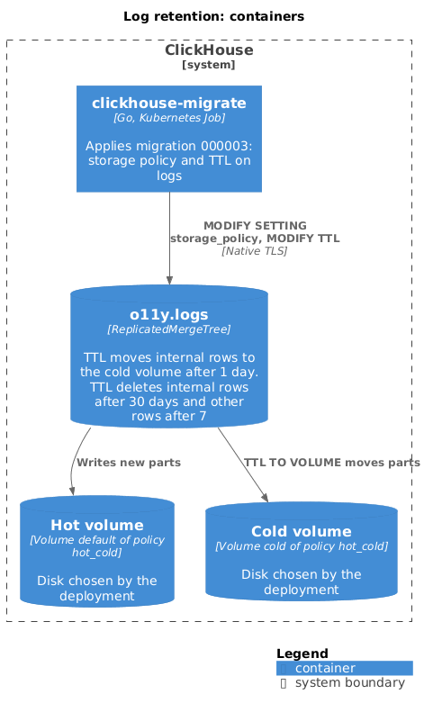

# Log retention

Log retention is a table TTL on `o11y.logs`, set by migration `000003`. Rows
of the `internal` project move to a cold volume after 1 day and are deleted
after 30 days. Rows of every other project stay on the hot volume and are
deleted after 7 days. The pipeline stores logs only, so this document covers
only `o11y.logs`.



## Migration 000003

[`000003_log_retention.up.sql`](../../config/clickhouse-migrations/migrations/000003_log_retention.up.sql)
runs two statements against `logs`:

```sql
ALTER TABLE logs MODIFY SETTING storage_policy = 'hot_cold';

ALTER TABLE logs MODIFY TTL
    toDateTime(ObservedTimestamp) + toIntervalDay(if(ProjectId = 'internal', 1, 36500)) TO VOLUME 'cold',
    toDateTime(ObservedTimestamp) + toIntervalDay(if(ProjectId = 'internal', 30, 7)) DELETE
```

| Project | Moves to `cold` | Deleted |
| --- | --- | --- |
| `internal` | 1 day after `ObservedTimestamp` | 30 days after `ObservedTimestamp` |
| Any other | After 36500 days, which means never | 7 days after `ObservedTimestamp` |

Both rules key on `ObservedTimestamp`, the collector's receipt time, so a
source with a wrong clock can't extend or shorten a record's life. See
[how `ObservedTimestamp` is derived](./logs.md#clickhouse-schema).

`internal` is the project that
[`transform/milo_project_id`](./logs.md#resource-attribute-contract) assigns
when no project resolves. Tenant logs stay on the hot volume for their whole
life.

ClickHouse applies the TTL when it merges parts, so a row can outlive its
deadline until the part that holds it merges. The table sets neither
`ttl_only_drop_parts` nor `merge_with_ttl_timeout`, so the server defaults
apply.

To change a value, add a later migration. No setting or environment variable
overrides these numbers.

## Storage policy

Migration `000003` fails unless the deployment defines a storage policy named
`hot_cold` with these volumes:

| Volume | Role |
| --- | --- |
| `default` | Hot. The volume the table was created on, so ClickHouse accepts the `MODIFY SETTING storage_policy` change |
| `cold` | Target of `TO VOLUME 'cold'` |

The repository doesn't define the disks behind the volumes. The deployment
chooses them; typically the hot volume is local block storage and the cold
volume is an object-storage disk.

## Partitions

`logs` partitions by `toYYYYMM(ObservedTimestamp)`. The longest retention is
30 days, so at most two monthly partitions hold data at a time. The partition
count doesn't depend on the number of projects, because the partition key
excludes `ProjectId`.

## Replication

A deployment runs the database as a `Replicated` database on ClickHouse
Keeper. `clickhouse-migrate` creates it with `CREATE DATABASE ... ON CLUSTER`
and `ENGINE = Replicated`. Tables are `ReplicatedMergeTree`, so each replica
applies the TTL to its own copy of the data. See
[ClickHouse schema](./logs.md#clickhouse-schema).

## ClickHouse system logs

ClickHouse's own system log tables, such as `system.trace_log` and
`system.text_log`, grow without bound unless a TTL limits them. This
repository ships no ClickHouse server configuration, so it sets no TTL for
them. The deployment sets those TTLs in its server configuration.

For where retention fits operationally, see the
[operations guide](../operations/README.md).
